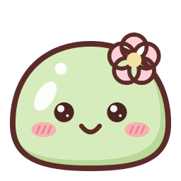
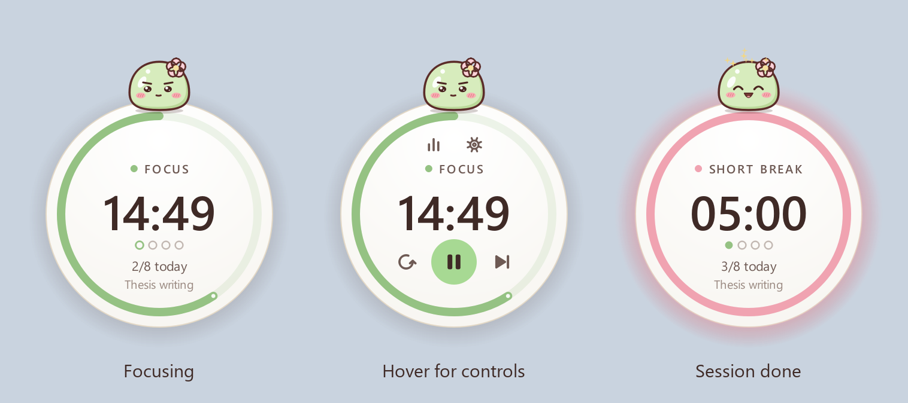
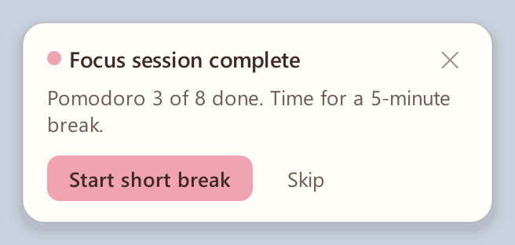
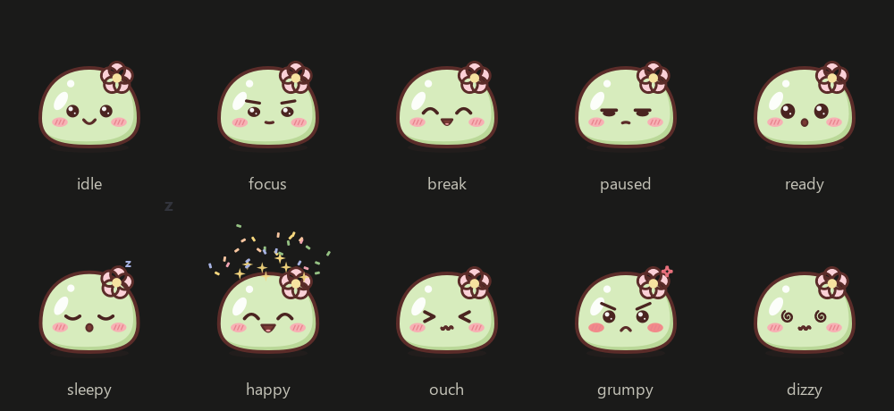
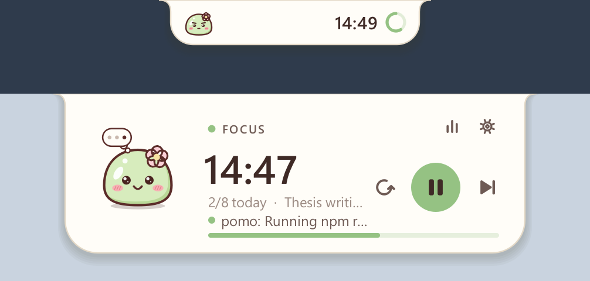
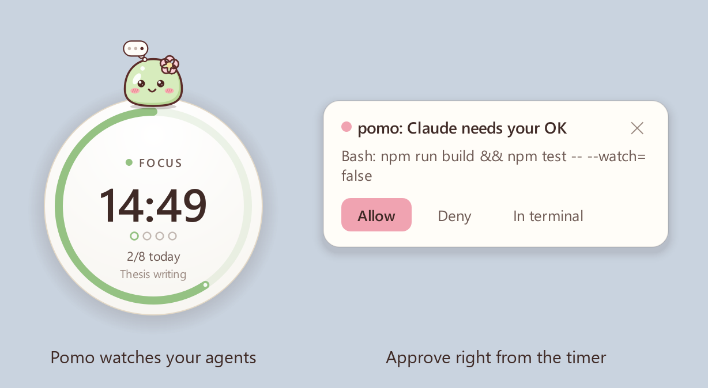
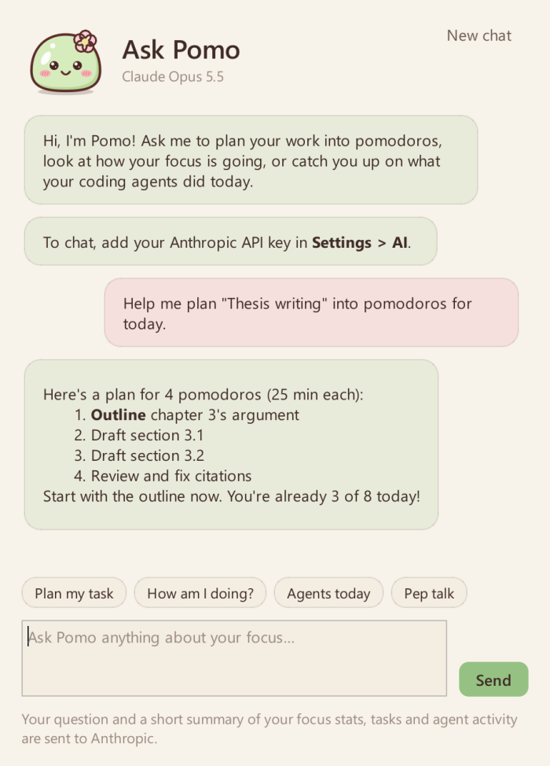
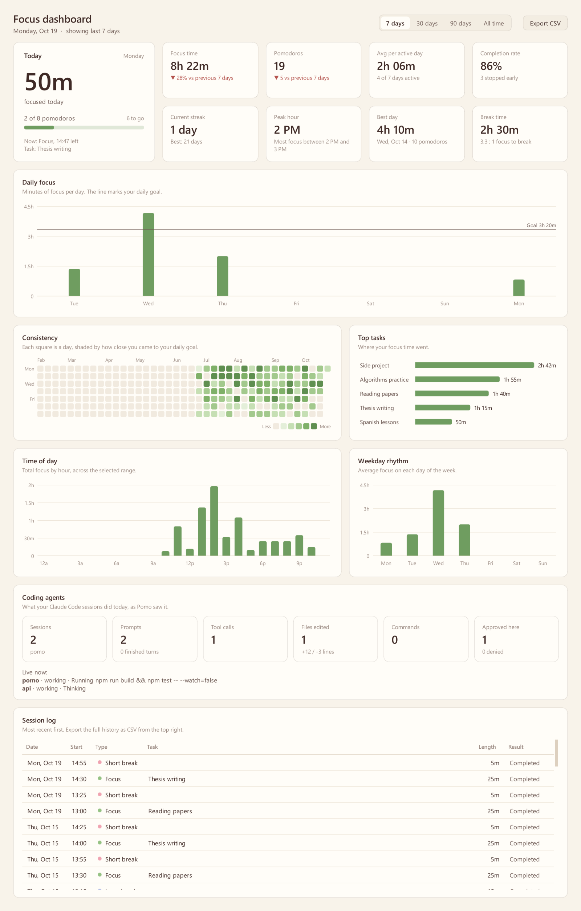

<div align="center">



# FocusOrb

**A cozy floating Pomodoro timer for Windows, with Pomo the focus buddy, a focus dashboard, and an eye on your coding agents.**

<a href="../../releases/latest/download/FocusOrb-Setup.exe"></a>

<sub>Windows 10 or 11 (64-bit) &middot; free &middot; no admin rights needed &middot; <a href="../../releases/latest/download/FocusOrb-portable.zip">portable zip</a> &middot; <a href="../../releases">all releases</a></sub>

<br><br>



</div>

## Install

1. Click **Download for Windows** above. You get `FocusOrb-Setup.exe`, and there is no need to download the source code.
2. Run it. The installer is not code-signed, so Windows SmartScreen may say *"Windows protected your PC"*. Click **More info**, then **Run anyway**.
3. Choose whether to add a desktop shortcut and to start FocusOrb when you sign in, then click **Finish**.

The timer appears in the bottom-right corner, just above the taskbar.

To update, download and run the newest installer; it replaces the old version and keeps your history. To uninstall, go to *Settings > Apps > Installed apps > FocusOrb*. You will be asked whether to keep your history.

Prefer no installer? Download the [portable zip](../../releases/latest/download/FocusOrb-portable.zip), extract it anywhere and run `FocusOrb.exe`.

## Features

- **Pomo, your focus buddy.** A little matcha mochi who sits on your timer and reacts to it (see below).
- **Two timer styles.** A floating round orb you can drag anywhere, or an island that hangs from the top edge of the screen.
- **Keeps an eye on your coding agents.** Pomo shows when Claude Code is working, finished, or needs you, and you can approve its requests right from the timer.
- **Ask Pomo.** Chat with Claude to plan your work into pomodoros, review your focus, or catch up on what your agents did.
- **Editable time.** Double-click the time and type `30`, `45:00` or `1:30:00`, or scroll over it to add or remove minutes.
- **Pomodoro turns.** Dots show your place in the cycle before the long break, and *3/8 today* tracks your daily goal.
- **Alerts when a session ends:** a Windows notification, a sound (four built-in), a pop-up card with *Start break* / *Skip*, and a soft glow on the timer.
- **Dashboard.** KPIs, charts, your agents' activity, a session log and CSV export.
- **Soft themes.** *Matcha* (cream and cocoa, the default) and *Cocoa* (warm dark brown), with pastel matcha, sakura and lavender for focus, short and long breaks.
- **Customizable.** Durations, cycle length, daily goal, auto-start, size, opacity and a color for each mode.

<div align="center"></div>

## Meet Pomo

Pomo is a soft matcha mochi with a sakura blossom. He sits on top of your timer and keeps you company:

- His eyes follow your cursor, and he blinks and breathes.
- He looks determined while you focus, and relaxes with happy closed eyes on breaks.
- He bounces when the next session is ready, and jumps for joy when you finish one. When you reach your daily goal, there's confetti.
- Leave the timer idle for a few minutes and he dozes off.
- Poke him: once is fine, a few times makes him grumpy, and keep going and he gets dizzy.
- While your coding agents work, a little thought bubble appears over his head. When one needs you, it turns into a "!".

<div align="center"></div>

Don't want a buddy? Turn off *Show Pomo* in *Settings > Appearance*.

## Top island

Prefer your timer out of the way? Set *Timer style* to **Top island** in *Settings > Appearance*, or right-click the timer and choose *Timer style > Top island*.

- **While a session runs:** the timer becomes a soft pill hanging from the top of the screen, showing a mini Pomo and the countdown.
- **Hover it:** it springs open with the controls, the progress bar, and what your agents are doing.
- **No timer or agent running:** it tucks into a thin sliver. Hover the top edge of the screen to bring it back.

<div align="center"></div>

## Keep an eye on your coding agents

FocusOrb can watch your [Claude Code](https://code.claude.com) sessions, so you can stay in your focus session and still know when an agent needs you.

<div align="center"></div>

**Connect it once:** open *Settings > Agents* and click **Connect Claude Code**. FocusOrb adds its hooks to `%USERPROFILE%\.claude\settings.json`. Your other settings are kept, and a backup is saved next to the file the first time. New Claude Code sessions pick it up.

What you get:

- **Live status.** Pomo's thought bubble while an agent works. The island and the right-click menu show each session's project and what it is doing (for example *pomo: Editing app.py*).
- **Approvals from the timer.** When Claude Code would ask for permission, a card shows the project and the exact command or file, with **Allow**, **Deny** and **In terminal**. If you don't answer within the wait time (60 seconds by default), Claude Code asks in the terminal as usual. Nothing is ever approved without your click.
- **Heads-up when it's done.** A notification when an agent finishes a long task (longer than 30 seconds by default) or is waiting for your input.
- **Today's activity** on the dashboard: sessions, prompts, tool calls, files edited, commands and approvals.

Watching never slows Claude Code down: everything except approvals runs in the background. If FocusOrb isn't running, Claude Code behaves exactly as before. Agent events stay on your PC: they travel over a local named pipe that only your Windows account can open.

To stop, click **Disconnect Claude Code** in the same place. Only FocusOrb's own entries are removed.

## Ask Pomo

Open **Ask Pomo** from the right-click menu or the tray to chat with Claude in Pomo's voice. It knows your timer, your focus stats, your current task and what your agents did today, so you can ask things like:

- *Plan my task*: splits your current task into pomodoro-sized steps.
- *How am I doing?*: observations about your week, and one suggestion.
- *Agents today*: a per-project summary of your coding agents' work.
- *Pep talk*: a nudge before your next session.

<div align="center"></div>

**Setup:** get an API key at [console.anthropic.com](https://console.anthropic.com) and paste it in *Settings > AI*. It is stored encrypted for your Windows account. FocusOrb uses Claude Opus 5.5 by default; you can pick Claude Sonnet 5.5 or Claude Haiku 5.5 instead. Usage is billed to your Anthropic account.

**Privacy:** nothing is sent until you ask something. Then FocusOrb sends your question plus a short summary: timer state, focus stats, task names and agent activity (project names, prompts and tool counts).

## Using the timer

| Action | How |
|---|---|
| Start / pause | Hover, then click the round play button, or press **Space** |
| Reset / skip | Hover buttons, or **R** / **S** |
| Edit the time | Double-click the time and type a value. When the timer is idle, whole minutes become the new default for that mode. While it is running, this changes the time left. |
| Nudge the time | Scroll over the timer: 1 min per notch (Shift or Ctrl: 5 min), or **Up** / **Down** |
| Move it | Drag anywhere on the circle (the orb only; the island stays at the top center) |
| Poke Pomo | Click him. Hover him to see your agents' status. |
| Everything else | Right-click: switch mode, add time, set task, daily goal, timer style, Ask Pomo, coding agents, dashboard, settings, hide, quit |
| Tray icon | Click to bring the timer back; double-click for the dashboard |

## Dashboard

Open it from the chart button on the timer, the right-click menu or the tray icon.



- **Today:** focus time, and pomodoros against your goal.
- **KPIs:** focus time and pomodoros (with change vs the previous period), average per active day, completion rate, current and best streak, peak hour, best day, and break time.
- **Charts:** daily focus with a goal line, a consistency heatmap, top tasks, time of day and weekday rhythm.
- **Coding agents:** today's sessions, prompts, tool calls, files edited, commands and approvals, plus what is running right now.
- **Session log:** a table of every session, with CSV export.
- **Range filter:** 7 days, 30 days, 90 days or all time.

## Settings

| Tab | What you can change |
|---|---|
| Timer | Focus, short and long break lengths; long break interval; daily goal; auto-start for breaks and for focus |
| Alerts | Notifications, pop-up card, sound, volume, repeats, idle reminder |
| Appearance | Matcha or Cocoa theme, timer style (orb or island), show Pomo, island auto-hide, orb size, opacity, fade while focusing, always on top, show task, colors for each mode |
| Agents | Connect or disconnect Claude Code, answer permission requests in FocusOrb, how long to wait for your answer, finish notifications |
| AI | Anthropic API key, model for Ask Pomo |
| General | Start with Windows, reset position, open data folder, export CSV, clear history |

Your data lives in `%APPDATA%\FocusOrb`: `settings.json`, `history.db` (pomodoros and agent activity) and, if you saved one, `ai_key.bin` (your API key, encrypted).

## For developers

### Run from source

From the project folder, in PowerShell or Command Prompt:

```powershell
.\run.bat
```

The first run creates a `.venv` and installs the dependencies (PySide6 and the Anthropic SDK). To try the dashboard with sample history (kept in a separate data folder), run `.\run.bat --demo`.

Run the tests with `python -m unittest discover -s tests -t .`.

### Build the installer locally

Install [Inno Setup 6](https://jrsoftware.org/isinfo.php) (`winget install JRSoftware.InnoSetup`), then run:

```powershell
.\build.bat
```

This runs the tests, then writes two files:

- `dist\FocusOrb-Setup.exe`, the installer
- `dist\FocusOrb-portable.zip`, the portable build

### Publish a release

The workflow in [`.github/workflows/release.yml`](.github/workflows/release.yml) builds the installer on every push. When you push a version tag, it also publishes a GitHub Release:

1. Bump `APP_VERSION` in [`pomodoro/__init__.py`](pomodoro/__init__.py) and commit.
2. Tag and push the tag:
   ```bash
   git tag v1.1.0
   git push origin v1.1.0
   ```
3. GitHub Actions builds `FocusOrb-Setup.exe` and `FocusOrb-portable.zip` and attaches them to the release.

The download button at the top of this README always points to the latest release, so it needs no edits.

### Project layout

```
main.py                     entry point, single-instance guard, hook mode
pomodoro/engine.py          timer state machine (monotonic clock, cycles, logging)
pomodoro/orb.py             the floating circular widget
pomodoro/island.py          the top-of-screen island
pomodoro/pomo.py            Pomo: drawing, moods and animation (all in code, no image files)
pomodoro/toast.py           pop-up cards (session alerts, agent approvals)
pomodoro/agents.py          live Claude Code sessions and approvals, over a local named pipe
pomodoro/hook.py            the hook client Claude Code runs (standard library only, starts fast)
pomodoro/claude_hooks.py    connects / disconnects FocusOrb in Claude Code's settings.json
pomodoro/ai.py              Ask Pomo: context and streaming requests through the Anthropic SDK
pomodoro/chat.py            the Ask Pomo window
pomodoro/keystore.py        API key storage, encrypted with Windows DPAPI
pomodoro/dashboard.py       dashboard window
pomodoro/charts.py          hand-painted charts (no matplotlib, keeps the build small)
pomodoro/settings_dialog.py settings window
pomodoro/app.py             controller: tray, menus, notifications, wiring
pomodoro/storage.py         SQLite history (pomodoros and agent events)
pomodoro/stats.py           KPI calculations
pomodoro/sounds.py          alert sounds synthesized at runtime
pomodoro/theme.py           Matcha and Cocoa color tokens, stylesheet
installer/FocusOrb.iss      Inno Setup installer script
tools/prepare_build.py      generates the .exe icon (Pomo) and version info
tests/                      unit tests
```

## Credits

The idea of a buddy that reacts to your work, a timer island at the top of the screen, and watching coding agents from it was inspired by [Coucou](https://github.com/Louis-CFM/coucou) by Louis Raillé. Pomo is an original character, and FocusOrb uses none of Coucou's code, artwork or sounds.
