<div align="center">


# Pomo

**A cozy Pomodoro timer for Windows, starring Pomo the matcha mochi. It comes with a focus dashboard, little games, and an eye on your coding agents.**

<a href="../../releases/latest/download/Pomo-Setup.exe"></a>

<sub>Windows 10 or 11 (64-bit) &middot; free &middot; no admin rights needed &middot; <a href="../../releases/latest/download/Pomo-portable.zip">portable zip</a> &middot; <a href="../../releases">all releases</a></sub>

<br><br>

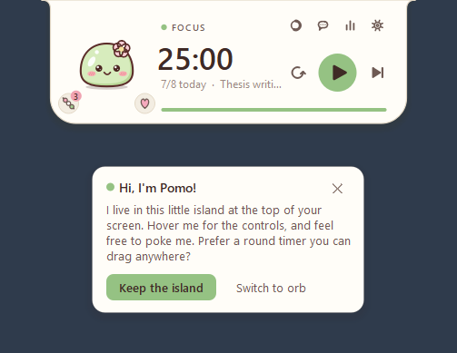

</div>

## Install

1. Click **Download for Windows** above. You get `Pomo-Setup.exe`, and there is no need to download the source code.
2. Run it. The installer is not code-signed, so Windows SmartScreen may say *"Windows protected your PC"*. Click **More info**, then **Run anyway**.
3. Choose whether you want a desktop shortcut and whether Pomo should run on startup, then click **Finish**.

Pomo opens as a little island at the top of your screen and says hi. Prefer a round timer you can drag anywhere? Click **Switch to orb** on the welcome card, or the style button on the timer whenever you like.

- **Update:** Pomo updates itself. When a new version is out, it downloads it in the background, checks it against GitHub's checksum, and offers **Update now**: one click and Pomo restarts on the new version, history and settings kept. It never asks during a focus session, and *Later* waits until tomorrow (or use *Update to Pomo...* in the right-click menu). On 1.4 or earlier, download and run the newest installer once; from 1.5 on, updates come to you. The portable zip shows a download link instead.
- **Uninstall:** *Settings > Apps > Installed apps > Pomo*. You will be asked whether to keep your history.
- **No installer:** download the [portable zip](../../releases/latest/download/Pomo-portable.zip), extract it anywhere and run `Pomo.exe`.

### Coming from FocusOrb?

Pomo used to be called FocusOrb. Run `Pomo-Setup.exe` and it removes FocusOrb for you. On its first launch, Pomo brings over your history, settings, saved API key and Claude Code connection. The old `%APPDATA%\FocusOrb` folder is left in place as a backup.

## What's inside

- **Pomo, your focus buddy.** A soft matcha mochi who lives on your timer, follows your cursor and reacts to everything (see [Meet Pomo](#meet-pomo)).
- **Two timer styles, one click apart.** A slim island at the top of the screen (the default), or a round orb you can drag anywhere. The style button on the timer switches between them.
- **Buttons right on the timer.** Ask Pomo, the dashboard, the timer style and settings are on the timer itself. No right-click needed.
- **Editable time.** Double-click the time and type `30`, `45:00` or `1:30:00`, or scroll over it to add or remove minutes.
- **Pomodoro turns.** Dots show your place in the cycle before the long break, and *3/8 today* tracks your daily goal.
- **Alerts when a session ends:** a Windows notification, a sound (four built in), a pop-up card with *Start break* / *Skip* and a one-tap *How was that?*, and a soft glow on the timer.
- **Pomo helps you focus.** It learns your best session length from one-tap ratings, gives you a side-eye when YouTube sneaks into a focus session, lets you park stray thoughts with a hotkey, and pauses when you step away.
- **"Where was I?" after breaks.** When a break ends, Pomo shows your task, the window you were working in, what your agents did while you were away and your parked thoughts. One click brings that window back to the front.
- **Sessions named for you.** Pomo picks up the project and git branch open in your editor and offers it as the session's task, so the dashboard shows focus per project with no typing.
- **Focus sounds.** Real rain and café recordings, brown noise and a soft lo-fi loop, playing on a seamless loop with nothing to download. Pomo puts on headphones and listens too.
- **Talk to Pomo.** Hold a shortcut and ask out loud, and let a soft voice read the replies.
- **Pomo on the taskbar.** The countdown fills Pomo's taskbar button, with reset, play/pause and skip when you hover it, like a music player.
- **Agent-paced pomodoros.** Take your break while your agent works on a long task, and get agent news on your break instead of in the middle of focus.
- **Ask Pomo can act.** "45 minutes on the thesis, then 10 off, three rounds" sets up the plan and starts the timer.
- **Breathe with Pomo.** A short guided break: box breathing, rest your eyes, stretch.
- **Daily quests and badges.** Three small goals a day, like "2 pomodoros before 10 AM", with a badge for each and new outfits now and then.
- **Focus garden.** A sakura tree that grows with every pomodoro and unlocks new outfits.
- **Pomo's room.** A cozy room on the dashboard that fills up with furniture you earn from focus hours, quests and Perfect days. Swap things around with a click.
- **Global shortcuts.** Start, pause, skip, park a thought, play music or talk to Pomo from any app.
- **Eight pastel themes and twenty-one outfits.** Pick your colors and dress Pomo up, or let Pomo dress for what you're doing; four outfits are earned in the focus garden and three with daily quests.
- **Answer your coding agent from Pomo.** See its exact message, answer Claude's questions, approve requests, and reply when it finishes a turn.
- **Things to play with.** Pet Pomo, feed treats you earn by focusing, and play Petal Catch, Mochi Stack or Memory Match on your break.
- **Music controls.** See what's playing on Spotify, YouTube or any other player, and play, pause or skip it from Pomo. Pomo puts on headphones and listens along.
- **Dashboard.** KPIs, charts, quests and badges, your agents' activity, a session log and CSV export.
- **Keeps an eye on your coding agents.** Claude Code, OpenAI's Codex CLI and Google's Gemini CLI: see when one is working, done, or needs you. When one changes files, Pomo suggests reviewing them as your next focus task.
- **Ask Pomo, with the AI you like.** Claude, ChatGPT, Gemini, Grok or anything on OpenRouter, with your own key and your choice of model, to plan your work into pomodoros or look back at your week.
- **Runs on startup** if you want it to: one switch in *Settings > General*.

<div align="center"></div>

## Two timer styles

**The island** (the default) hangs from the top edge of your screen:

- **While a session runs**, it's a small pill with a mini Pomo and the countdown.
- **Hover it** and it opens up with the controls, the buttons, a progress bar and what your agents are doing.
- **When nothing is running**, it stays put. Turn on *Tuck the island away when idle* in *Settings > Appearance* to shrink it to a thin sliver instead; hover the top edge of the screen to bring it back.

<div align="center"></div>

**The orb** floats in the bottom-right corner, just above the taskbar. Drag it anywhere. Hover it for the buttons: dashboard, Ask Pomo, timer style and settings along the top, and play, reset and skip below the time.

<div align="center"></div>

### On the taskbar

Pomo also has a button on the Windows taskbar. While a session runs, the countdown fills it (green while it runs, yellow while it's paused), and its label counts down too. Hover it for a live picture of the timer with **reset**, **play/pause** and **skip** underneath, like a music player. When a coding agent needs you, a small "!" appears on the button. Click the button to bring the timer up.

<div align="center">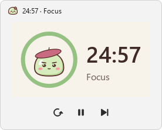</div>

Prefer Pomo in the tray only? Turn off *Show Pomo on the taskbar* in *Settings > General*. *Close window* on the button hides it until Pomo next starts.

## Meet Pomo

Pomo is a soft matcha mochi with a sakura blossom who sits on your timer and keeps you company:

- Pomo's eyes follow your cursor, and Pomo blinks and breathes.
- Pomo looks determined while you focus, relaxes with happy closed eyes on breaks, and sometimes does a little dance.
- Pomo bounces when the next session is ready and jumps for joy when you finish one. Reach your daily goal and there's confetti.
- Leave the timer idle for a few minutes and Pomo dozes off.
- Poke Pomo: once is fine, a few times gets you a grumpy face, and keep going for a dizzy one.
- While your coding agents work, a little thought bubble appears over Pomo's head. When one needs you, it turns into a "!".

<div align="center"></div>

Don't want a buddy? Turn off *Show Pomo* in *Settings > Appearance*.

## Play with Pomo

- **Pet:** rub your cursor back and forth over Pomo for hearts.
- **Twirl:** double-click Pomo.
- **Treats:** every finished focus session earns a dango (you can save up to 9). Click the dango next to Pomo to feed one.
- **Games:** click the petal next to Pomo (it shows on hover and during breaks), or *Play a game* in the right-click menu, and pick one of three. Each keeps your best score. Open one during a focus session and Pomo will suggest saving it for your break.
  - **Petal Catch:** a 30-second round. Move Pomo with your mouse or the arrow keys to catch falling sakura petals. Golden petals are worth 3.
  - **Mochi Stack:** a mochi glides back and forth above a tower of mochis. Click (or press Space) to drop it onto the one below. Land it close and the tower grows; a dead-center drop is worth 2. Miss by more than half a mochi and it tumbles off. Each one glides a little faster.
  - **Memory Match:** sixteen cards, eight of Pomo's outfits in pairs. Turn two at a time and clear the board in as few moves as you can.

<div align="center">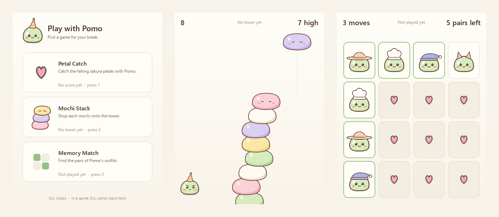</div>

<div align="center">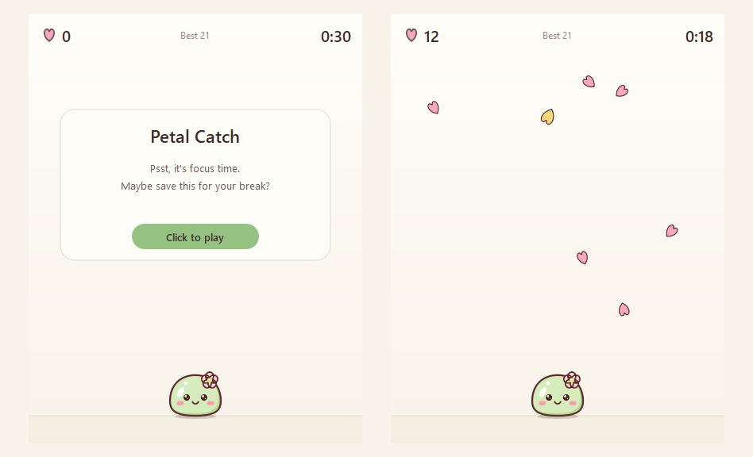</div>

## Listen along

Playing music on Spotify, YouTube in your browser, or any app that shows up in Windows' media controls? Pomo shows what's playing and lets you control it without leaving your focus.

<div align="center">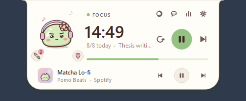</div>

- **On the island,** a now-playing row appears under the timer, with the cover, the song, and previous, play/pause and next.
- **On the orb,** a little music badge sits on the rim, with dancing bars while a song plays. Click it for a mini player.
- **From the right-click menu,** *Music* has the same controls.
- **Pomo listens too.** While music plays, Pomo puts on headphones (under any hat), sways along, and little notes float up. A new song gets a happy bop.
- **Songs left.** During a focus session the music shows roughly how many songs are left until your break.
- **Music follows the timer** (off unless you turn it on in *Settings > General*): your music plays while you focus and pauses on breaks.

<div align="center">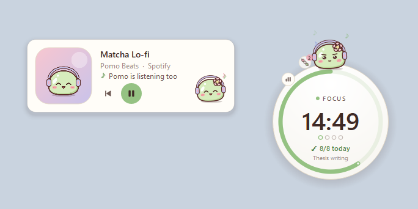</div>

Pomo reads what's playing through Windows' own media controls, and nothing leaves your PC. Turn either part off in *Settings > General*.

### Focus sounds

No music app needed: Pomo has its own focus sounds. Pick one with the headphones button beside Pomo on the island (or on the orb's rim), in *Focus sounds* in the right-click menu, or in *Settings > General*:

- **Rain:** a recording of steady, relaxing rain, in stereo.
- **Café murmur:** a recording of a café: soft chatter and the clink of cups.
- **Brown noise:** deep and even, to cover a noisy room.
- **Lo-fi loop:** a soft eight-bar loop, with a lazy beat and a little vinyl crackle.

A sound you pick plays on a loop until you pick *Off*, with no gap or click where it starts over. Prefer silence on your breaks? Turn on *Only while I focus* and it plays during focus sessions and fades out for breaks. Pomo puts on headphones and listens along.

Rain and café come with Pomo. The first time you play one, Pomo prepares it as a seamless loop (under a second, using Windows' own audio decoder) and keeps it in its cache folder; on a PC that can't decode MP3, Pomo makes a synthesized version instead. Brown noise and the lo-fi loop are synthesized on your PC. Nothing is downloaded, and the sounds play alongside your alert sounds without touching your system volume.

<div align="center">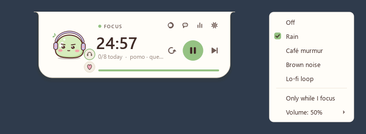</div>

## Pomo helps you focus

### Learns what works for you

When a focus session ends, the card asks *How was that?* with three Pomo faces: tough, okay and great. After a few answers, Pomo compares your session lengths and times of day. When another length clearly suits you better, it suggests switching (at most once a week). A session you stop early counts as a tough one.

<div align="center">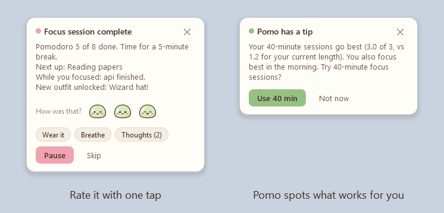</div>

### A gentle distraction check-in

This is off unless you turn on *Notice distracting apps and sites* in *Settings > Focus*. Then, during a focus session, Pomo notices when something on your list (YouTube, Reddit, Netflix and so on) has been in front for 20 seconds. You get a long side-eye and a quiet *Psst... YouTube?* card. Nothing is blocked, and *It's for work* takes that one off your list. The dashboard shows your focus score and where your focus time went.

Pomo only looks at which app is in front, plus the site name in a browser's title, never at what's in the window. It keeps app names and minutes on your PC.

<div align="center">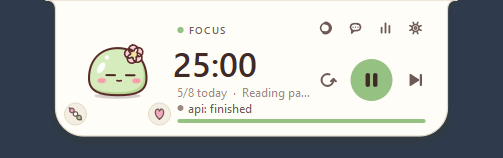</div>

### Away from the PC

If the keyboard and mouse have been still for 5 minutes during a focus session, Pomo pauses it and gives that time back. When you return, choose *Resume*, or *It was focus time* if you were reading or thinking. Change the wait, or turn it off, in *Settings > Focus*.

<div align="center">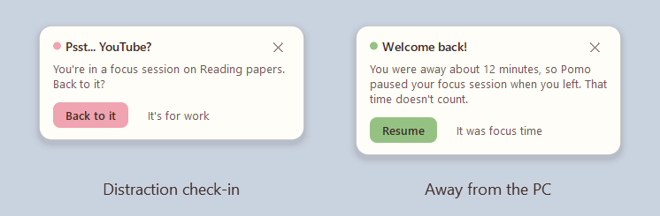</div>

### A little cheer

Pomo cheers you on during a focus session, gently: at halfway, with 5 minutes left and in the last minute, he gives a small hop and says a few warm words (*Halfway through Thesis!*, *5 minutes to go. Finish strong!*) in a little bubble beside the timer. It fades after a few seconds, makes no sound, and clicks go straight through it. Short sessions get fewer cheers, and Pomo stays quiet while a card is on screen. Turn it off with *During focus* in *Settings > Focus*.

<div align="center">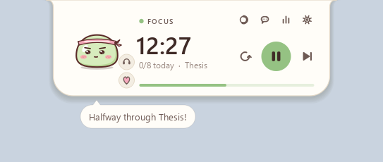</div>

### Where was I?

When a break ends, the card tells you where you left off:

- **your task**,
- **the window you were working in** (say, *VS Code · pomo* or *Word · Thesis draft*),
- **what your coding agents did while you were away** (*api finished and changed 4 files, web is waiting for you*),
- **your parked thoughts**, and a review your agent left you, if there is one.

**Back to VS Code** starts your focus session and brings that window back to the front in one click. *Start here* just starts the session. You get the same card if you skip a break. Turn it off with *When a break ends* in *Settings > Focus*.

### Sessions named after your project

Start a focus session without a task and Pomo looks at the editor you were just in: the project open there and its git branch. It asks *Working on pomo?*, and one click names the session *pomo* (or *pomo · fix-login* away from the main branch), so the dashboard's *Top tasks* shows your focus per project without any typing. *Always, without asking* names them for you from then on; set it back in *Settings > Focus*.

It works with VS Code and the editors built on it (Cursor, Windsurf, VSCodium...), JetBrains IDEs, Visual Studio and Sublime Text, and with a terminal that shows its folder in the title. Pomo matches the window title to folders your editor recently opened and folders your coding agents work in, then reads the branch from the repository's `.git/HEAD`. The project also appears first in *Set task*.

Window titles stay in memory: Pomo never writes them down.

<div align="center">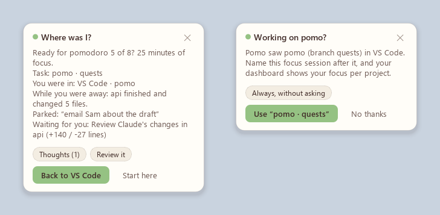</div>

### Park a thought

Something pops into your head mid-focus? Press **Ctrl+Alt+Shift+N** from any app, type it and press Enter, and you're back to work. Parked thoughts wait for you on the break card and in *Parked thoughts* in the right-click menu. There you can tick them off, or have Ask Pomo turn them into a plan.

<div align="center">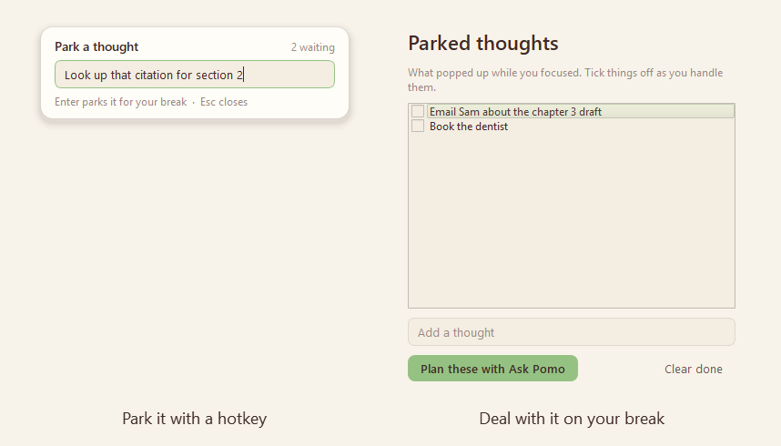</div>

### Breathe with Pomo

When a break starts, the card offers *Breathe*. Pomo guides you through about a minute and a half of rest: four rounds of box breathing (in for 4 seconds, hold, out, hold) while Pomo inflates and deflates, 20 seconds to rest your eyes on something far away, and a stretch. It's also in the right-click menu.

<div align="center">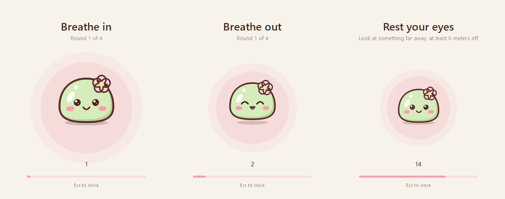</div>

### Quiet focus

During a focus session, Pomo holds its own alerts that can wait, like an agent finishing or waiting for you, and shows them together when your break starts. Permission requests still come through right away.

Windows doesn't let apps switch on its own Focus or Do not disturb (that API is limited to apps Microsoft approves), so this is Pomo keeping itself quiet. It can't silence other apps.

### Global shortcuts

| Shortcut | Does |
|---|---|
| **Ctrl+Alt+Shift+P** | Start or pause the timer |
| **Ctrl+Alt+Shift+K** | Skip to the next session |
| **Ctrl+Alt+Shift+N** | Park a thought |
| **Ctrl+Alt+Shift+M** | Play or pause music |
| **Ctrl+Alt+Shift+H** | Show or hide the timer |
| **Ctrl+Alt+Shift+Space** (hold) | Talk to Pomo: speak while you hold it, let go to ask |

They work from any app. Change or turn them off in *Settings > Shortcuts*.

## Focus garden

Every finished pomodoro grows a sakura tree on your dashboard. It goes from a sprout to a grand sakura over your first 250 pomodoros, with one blossom for each pomodoro in the range you're viewing. Milestones unlock new outfits for Pomo: cat ears at 10 pomodoros, a flower crown at 25, a graduation cap at 50 and a wizard hat at 100.

<div align="center">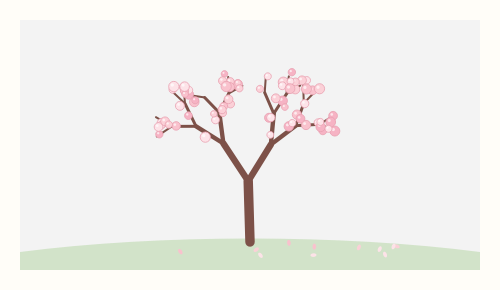</div>

## Daily quests and badges

Each morning Pomo picks three small quests for the day, from the ones that fit how you use it (no agent quests if you don't use coding agents, no early-bird quest after 9). For example:

| Quest | Goal |
|---|---|
| Early bird | Finish 2 pomodoros before 10 AM |
| Laser focus | Finish a whole session with no pauses or distractions |
| Hat trick | Finish 3 pomodoros in a row, none stopped early |
| Deep dive | Finish a focus session of 45 minutes or more |
| Parking pro | Park 2 stray thoughts instead of chasing them |
| Playtime | Play a mini game on a break |
| Code reviewer | Finish a focus session reviewing your agent's changes |
| Perfect timing | Take a break while a coding agent works |

There are thirteen in all. Each one you finish earns its badge (badges count up when you earn them again), and finishing all three in a day earns *Perfect day*. Quests also unlock outfits: a star clip at 5 quests, bunny ears at 15 and a strawberry hat at 30.

Pomo tells you when you finish one, on your break card if you're mid-session. Today's quests are in the right-click menu, and the dashboard shows them with your badge shelf. Turn them off in *Settings > Focus*.

<div align="center">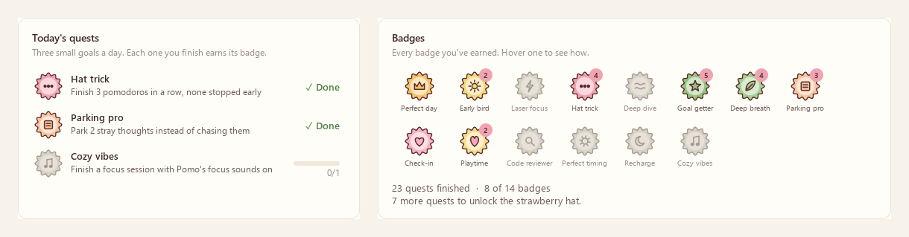</div>

## Pomo's room

Pomo has a room on the dashboard. It starts with a cushion and a rug under a window, and fills up as you go: focus hours, daily quests and Perfect days each earn something new.

| Earned with | Items (and what it takes) |
|---|---|
| Focus hours | Succulent (1), Little desk (3), Wall clock (5), String lights (10), Bookshelf (15), Monstera (25), Sakura curtains (35), Bean bag (50), Floor lamp (70), Study desk (100), Sakura bonsai (150), Cloud sofa (200) |
| Daily quests | Sakura print (3), Heart rug (10), Trophy shelf (20), Fish bowl (40) |
| Perfect days | Starry curtains (3), Sleepy cat (7) |

A new item moves straight in, and the card at the end of your session says so (*See room* takes you there). Click any spot in the room to swap what's there for something else you've earned, or leave it empty, and click Pomo to poke him. *Room items* shows what's next to earn and everything so far.

The room keeps time with you. The window goes from sunrise to blue sky to sunset to stars, the string lights and lamps glow in the evening, and Pomo dozes off late at night. The wall clock shows the real time, and the trophy shelf shows your top badges. Open the room from the dashboard or with *Pomo's room* in the right-click menu.

<div align="center">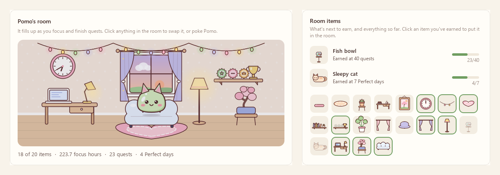</div>

## Themes and outfits

Pick a theme in *Settings > Appearance* or from the right-click menu: **Matcha** (the default), **Sakura**, **Lavender**, **Peach** and **Mint** are light; **Cocoa**, **Blueberry** and **Plum** are dark.

<div align="center">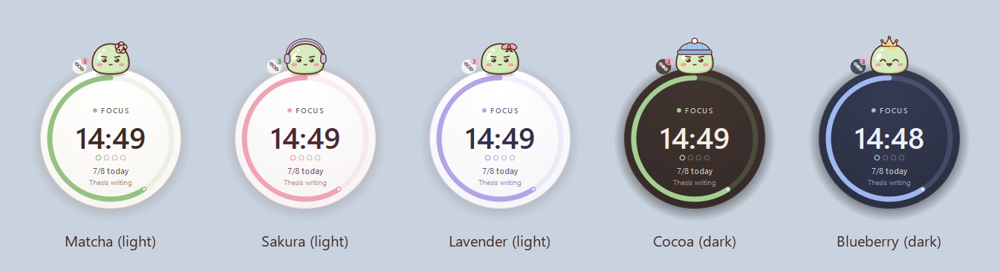</div>

Pomo has twenty-one outfits. Four are earned in the [focus garden](#focus-garden) (the number is the pomodoros it takes) and three with [daily quests](#daily-quests-and-badges). Choose one under *Pomo's outfit* in *Settings > Appearance* or in the right-click menu.

<div align="center">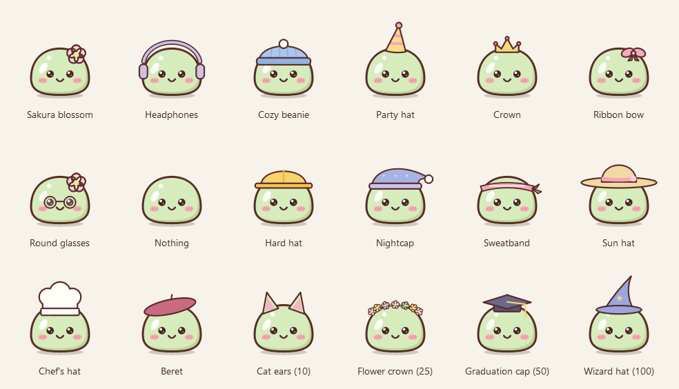</div>

**Pomo dresses for what you're doing.** A sweatband while you focus, a sun hat on breaks, a hard hat while your agents work, headphones when music plays, a beret in Ask Pomo, glasses on the dashboard, a party hat in Petal Catch and a nightcap when the timer's been idle a while. Your own pick shows the rest of the time. Turn it off in *Settings > Appearance* to keep one outfit on.

<div align="center">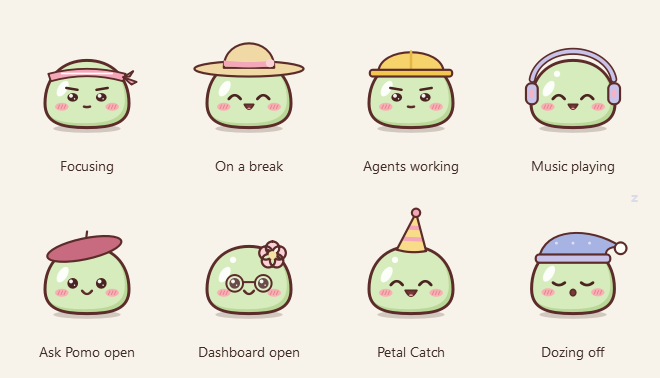</div>

## Keep an eye on your coding agents

Pomo can watch your [Claude Code](https://code.claude.com), [Codex CLI](https://github.com/openai/codex) and [Gemini CLI](https://github.com/google-gemini/gemini-cli) sessions, so you can stay in your focus session and still know when an agent needs you.

<div align="center"></div>

**Connect it once:** open *Settings > Agents* and click **Connect Claude Code**. Pomo adds its hooks to `%USERPROFILE%\.claude\settings.json`. Your other settings are kept, and a backup is saved next to the file the first time. New Claude Code sessions pick it up.

What you get:

- **Live status.** Pomo's thought bubble while an agent works. The island and the right-click menu show each session's project and what it is doing (for example *pomo: Editing app.py*).
- **Approvals from Pomo.** When Claude Code would ask for permission, a card shows the project and the exact command or file, with **Allow**, **Deny** and **In terminal**. If you don't answer within the wait time (60 seconds by default), Claude Code asks in the terminal as usual. Nothing is ever approved without your click.
- **Heads-up when it's done.** A notification when an agent finishes a long task (longer than 30 seconds by default) or is waiting for your input.
- **Today's activity** on the dashboard: sessions, prompts, tool calls, files edited, commands and approvals.
- **Changes to review.** When an agent finishes a turn that changed files, Pomo offers them as your next focus task (see [below](#review-your-agents-changes)).

### Codex CLI and Gemini CLI

Connect them the same way, with **Connect Codex** and **Connect Gemini** in *Settings > Agents*:

- **Codex CLI:** Pomo adds its hooks to `%USERPROFILE%\.codex\hooks.json`. Codex asks you to trust new hooks once: run `/hooks` in Codex and trust Pomo's. You get live status, approvals in Pomo (Allow, Deny, Deny with a note), changes to review (Codex's patches are counted file by file), and replies when a turn ends.
- **Gemini CLI:** Pomo adds its hooks to `%USERPROFILE%\.gemini\settings.json` (needs a Gemini CLI with hooks). Gemini runs every hook in line, so Pomo only listens to what it needs: your prompts, file edits and commands, the end of a turn and its notifications. You get live status, changes to review, a heads-up when it waits for permission in the terminal, and replies when a turn ends.

Cards and notifications name the agent (*web: Codex finished*). As with Claude Code, your other settings are kept, a backup is saved the first time, and *Disconnect* removes only Pomo's entries. Multiple-choice questions are answered in Pomo for Claude Code only, since only Claude Code lets a hook answer them.

### Answer Claude from Pomo

When you're away from your terminal (Pomo checks whether a terminal or code editor is in front), Claude Code's messages come to Pomo, word for word:

- **Questions.** When Claude asks a multiple-choice question, the card shows the question and every option exactly as Claude wrote them. Click an answer, or type your own, and Claude carries on with it.
- **When a turn ends.** The card shows Claude's final message, and you can type a reply that Claude picks up as your next instruction. *Done* (or no reply within 45 seconds) lets Claude stop as usual.
- **Permission prompts.** Besides *Allow*, *Deny* and *In terminal*, *Deny with a note* tells Claude what to do instead.

At your terminal, nothing waits: Claude Code asks and stops there as usual, and Pomo only shows the news. Turn each part on or off in *Settings > Agents*.

<div align="center">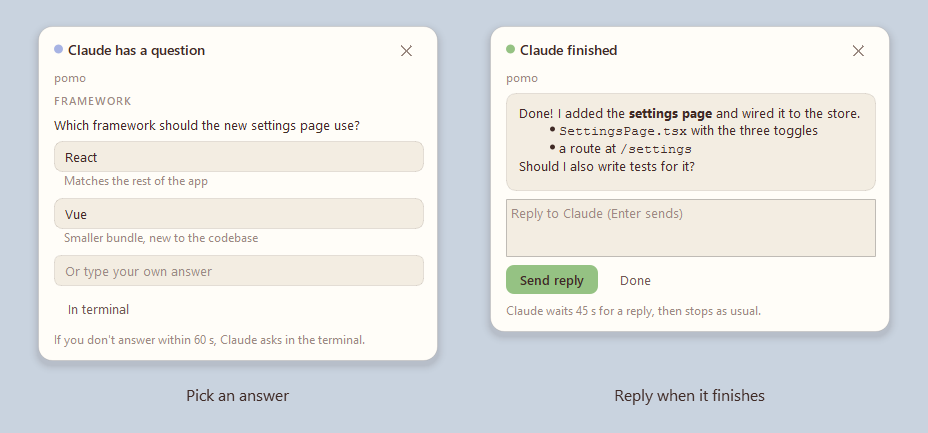</div>

### Review your agents' changes

Agents write code; somebody has to read it. When an agent finishes a turn that changed files, Pomo turns that into focus work for you:

- **The finish notice offers it.** *api: Claude finished. It changed 4 files (+138 / -26 lines): limits.py, app.py, test_limits.py and README.md. Review them in your next focus session?* **Review next** makes *Review Claude's changes in api* your next focus task (straight after the session you're in, or first in your plan).
- **It waits for you.** Reviews you leave for later wait in *Reviews waiting* in the right-click menu, on the dashboard, and on the "Where was I?" card when your break ends. More changes in the same project add up to one review.
- **Done when you've focused on it.** Finish a focus session on a review and it leaves the list (and counts toward the *Code reviewer* quest).

During quiet focus the offer waits for your break card. Turn it off in *Settings > Agents*. Line counts are estimated from the edits the agent made.

<div align="center">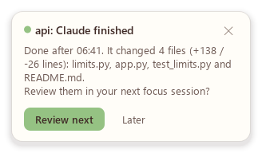</div>

### Agent-paced pomodoros

Pomo fits your focus sessions around your agents:

- **Break while it works.** When Claude has been on a long task (2 minutes by default) and you're well into a focus session, Pomo offers your break now. *Break now* counts the session as done, and Pomo tells you when Claude finishes.
- **Focus while you wait.** When Claude starts a long task and your timer is idle, Pomo suggests a focus session of your own.
- **News on your break.** During focus, finished and waiting notices are held and shown together on your break card. Permission requests still come through right away.
- **Back to focus.** When Claude finishes during your break, the notice offers to start your next focus session.
- **On the dashboard:** how long your agents worked today, and how much of it overlapped with your focus and your breaks.

<div align="center">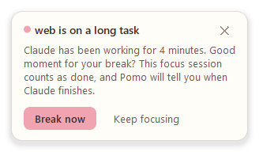</div>

Watching never slows Claude Code or Codex down: everything except answering runs in the background. (Gemini CLI runs every hook in line, so Pomo listens to only a few of its events, each a quick hand-off.) If Pomo isn't running, your agent behaves exactly as before. Agent events stay on your PC: they travel over a local named pipe that only your Windows account can open.

To stop, click **Disconnect** for that agent in the same place. Only Pomo's own entries are removed.

## Ask Pomo

Click the chat button on the timer to chat with Pomo, powered by the AI of your choice. Pomo knows your timer, your focus stats, your current task and what your agents did today, so you can ask things like:

- *Plan my task*: splits your current task into pomodoro-sized steps.
- *My week*: observations about your week, and one suggestion.
- *My day*: a short review of today.
- *Agents today*: a per-project summary of your coding agents' work.
- *Pep talk*: a nudge before your next session.

<div align="center"></div>

**Ask Pomo can do it for you.** Say what you want and Pomo sets it up. It can start a focus session or a break, set your current task, line up a plan of tasks (each with a number of pomodoros), and change your session lengths. A line in the chat shows what it did. Your plan is in the right-click menu, and when a focus session ends the card tells you what's next.

<div align="center">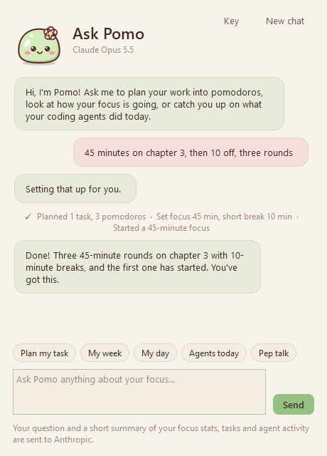</div>

**Review my day.** The *My day* chip asks for a short review of your day: what you got done, how your sessions felt, what your agents did, and one thing to carry into tomorrow. From 6 PM (change it in *Settings > AI*), Pomo offers this review once a day. It only asks the AI if you say yes.

**Pick your AI, bring your own key.** There is no subscription: you pay the provider directly for what you use.

| Provider | Models to start with | Key from |
|---|---|---|
| Anthropic (Claude), the default | Claude Opus 5.5, Sonnet 5.5, Haiku 5.5, Fable 5.1, Opus 5 | [console.anthropic.com](https://console.anthropic.com/settings/keys) |
| OpenAI (ChatGPT) | GPT-5.4, GPT-5.4 mini, GPT-5.4 nano | [platform.openai.com](https://platform.openai.com/api-keys) |
| Google Gemini | Gemini 3.5 Flash, Gemini 3.1 Pro (preview), Gemini Flash (latest) | [aistudio.google.com](https://aistudio.google.com/apikey) |
| xAI (Grok) | Grok 4.6, Grok 4.3 | [console.x.ai](https://console.x.ai) |
| OpenRouter | Auto, plus hundreds of models from every lab behind one key | [openrouter.ai](https://openrouter.ai/keys) |

1. The first time you open Ask Pomo, it asks for a key. Click **Get a key**, create one, and paste it in.
2. Pomo checks the key with a free call that uses no tokens. Then you're ready to chat.
3. Click the model name under *Ask Pomo* to switch provider or model at any time.

New models come out all the time, so in *Settings > AI* you can also click **Load models** to see every model your key can use, or type any model ID. Each provider's key is stored encrypted for your Windows account and is only ever sent to that provider. If no key is saved, Pomo uses `ANTHROPIC_API_KEY`, `OPENAI_API_KEY`, `GEMINI_API_KEY`, `XAI_API_KEY` or `OPENROUTER_API_KEY` from your environment.

<div align="center">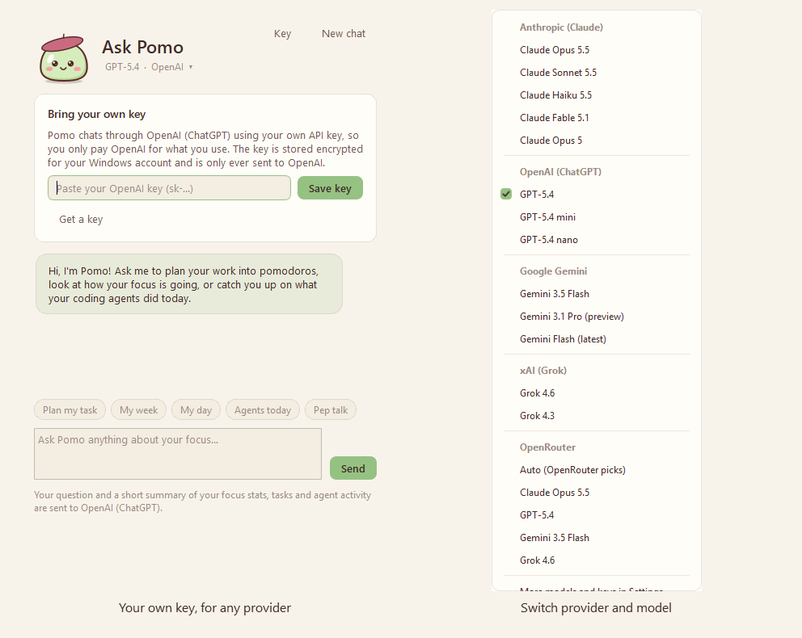</div>

**Privacy:** nothing is sent until you ask something. Then Pomo sends, to the provider you picked, your question plus a short summary: timer state, focus stats, task names, your plan, parked thoughts, how your sessions felt, your focus score, and agent activity (project names, prompts and tool counts).

### Talk to Pomo

Ask out loud instead of typing:

- **From any app:** hold **Ctrl+Alt+Shift+Space**, say your question, and let go. A little card shows Pomo listening; then Ask Pomo opens with your question and answers it.
- **In Ask Pomo:** hold the mic button while you speak, or click it once and just talk: Pomo stops when you pause (or when you click again).
- **Replies read aloud:** click the speaker in Ask Pomo's header (or turn on *Read Pomo's replies aloud* in *Settings > AI*) and Pomo reads its answers in a soft voice, its mouth moving along. It stops when you ask something new.

Who turns your voice into text is up to you (*Settings > AI*, *Talk to Pomo: hear me with*):

| Choice | How | Your voice goes to |
|---|---|---|
| This PC | Windows' own speech recognition, offline | Nowhere: it stays on your PC |
| OpenAI | OpenAI's transcription, with your OpenAI key (the most accurate) | OpenAI |
| Gemini | A Gemini model, with your Gemini key | Google |
| Automatic (the default) | OpenAI or Gemini when Ask Pomo already uses that provider, this PC otherwise | As above |

Replies are read by a Windows voice on your PC (pick one in *Settings > AI*). Pomo uses Windows' speech engines through Windows PowerShell, so there's nothing extra to install. Windows asks whether desktop apps may use your microphone (*Settings > Privacy & security > Microphone*); Pomo only listens while you hold the shortcut or the mic.

<div align="center">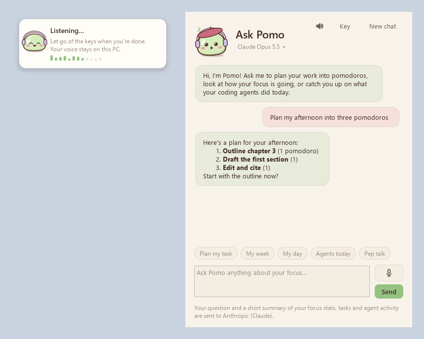</div>

## Using the timer

| Action | How |
|---|---|
| Start / pause | Hover, then click the round play button, or press **Space** |
| Reset / skip | The buttons next to play, or **R** / **S** |
| Edit the time | Double-click the time and type a value. When the timer is idle, whole minutes become the new default for that mode. While it is running, this changes the time left. |
| Nudge the time | Scroll over the timer: 1 min per notch (Shift or Ctrl: 5 min), or **Up** / **Down** |
| Dashboard, Ask Pomo, timer style, settings | The small buttons along the top of the timer (hover to see them) |
| Move it | Drag the orb anywhere. The island stays at the top center. |
| Play | Poke, pet or double-click Pomo; click the dango to feed a treat or the petal for the games |
| Music | The now-playing row on the island, or the music badge on the orb: previous, play/pause, next |
| Focus sounds | The headphones button beside Pomo on the island, or on the orb's rim |
| From any app | The [global shortcuts](#global-shortcuts): start or pause, skip, park a thought, music, show or hide, talk to Pomo |
| Taskbar | Hover Pomo's taskbar button for reset, play/pause and skip; click it to bring the timer up |
| Everything else | Right-click: switch mode, add time, set task, your plan, park a thought, parked thoughts, daily goal, timer style, theme, outfit, Ask Pomo, Talk to Pomo, games, Breathe with Pomo, focus sounds, today's quests, music, reviews waiting, coding agents, run on startup, hide, quit |
| Tray icon | Click to bring the timer back; double-click for the dashboard |

## Dashboard

Open it with the chart button on the timer, from the right-click menu or by double-clicking the tray icon.


- **Today:** focus time, and pomodoros against your goal.
- **KPIs:** focus time and pomodoros (with change vs the previous period), average per active day, completion rate, current and best streak, peak hour, best day, and break time.
- **Charts:** daily focus with a goal line, a consistency heatmap, top tasks, time of day and weekday rhythm.
- **Focus garden:** your sakura tree and the next outfit to earn.
- **Insights:** your best focus length, how your sessions felt, your focus score, and where your focus time went.
- **Quests and badges:** today's three quests with their progress, and every badge you've earned.
- **Pomo's room:** the room you're furnishing, what's next to earn, and every item so far.
- **Coding agents:** today's sessions, prompts, tool calls, files edited, commands and approvals, how long agents worked and how much of it overlapped with your focus and breaks, what is running right now, and the changes waiting for your review.
- **Session log:** a table of every session, with CSV export.
- **Range filter:** 7 days, 30 days, 90 days or all time.

## Settings

| Tab | What you can change |
|---|---|
| Timer | Focus, short and long break lengths; long break interval; daily goal; auto-start for breaks and for focus |
| Focus | Session ratings and length tips, Pomo cheering you on, away detection, the distraction check-in and its list, quiet focus, the break card, "Where was I?" when a break ends, naming sessions after your project (ask, automatically or off), daily quests |
| Alerts | Notifications, pop-up card, sound, volume, repeats, idle reminder |
| Appearance | Theme, timer style (island or orb), show Pomo, Pomo's outfit, Pomo dressing for what you're doing, tuck the island away when idle, orb size, opacity, fade while focusing, always on top, show task, colors for each mode |
| Agents | Connect or disconnect Claude Code, Codex CLI and Gemini CLI, suggesting reviews of agent changes, answer permission requests in Pomo, how long to wait for your answer, finish notifications, answering Claude's questions, replying when a turn ends (and how long the agent waits), break suggestions for long agent tasks |
| AI | Provider and model for Ask Pomo, your key for each provider (save, check, remove), load your models, when to offer the day review, who hears you when you talk to Pomo, reading replies aloud and the voice |
| Shortcuts | Global shortcuts on or off, and each key combination (including the talk shortcut) |
| General | Run Pomo on startup, updates (on or off, check now, update now), Pomo on the taskbar, focus sounds (which one, volume, only while focusing), music controls, Pomo listening along, music following the timer, move the orb back to its corner, open the data folder, export CSV, clear history |

Your data lives in `%APPDATA%\Pomo`: `settings.json` (with your quests, badges and reviews waiting), `history.db` (pomodoros with their ratings, agent activity, parked thoughts and, if the check-in is on, minutes per app), `cache\` (the focus sounds once they're made), `updates\` (a downloaded update until it's installed) and, if you saved one, `ai_key.bin` (your API key, encrypted). Window titles (for "Where was I?" and project names) are never written to disk. When you talk to Pomo, the recording and the replies it reads aloud only pass through a temporary file in `cache\`, deleted as soon as Windows is done with it. To check for updates, Pomo asks GitHub's public API for the latest release every few hours; nothing about you is sent with it.

## For developers

### Run from source

From the project folder, in PowerShell or Command Prompt:

```powershell
.\run.bat
```

The first run creates a `.venv` and installs the dependencies (PySide6 and the Anthropic SDK). To try the dashboard with sample history (kept in a separate data folder), run `.\run.bat --demo`.

Run the tests with `python -m unittest discover -s tests -t .`.

Pomo doesn't see your music? Run `python main.py --media-check` (or `Pomo.exe --media-check | more` in an installed copy). It prints the media sessions Windows reports and the song Pomo would show.

### Build the installer locally

Install [Inno Setup 6](https://jrsoftware.org/isinfo.php) (`winget install JRSoftware.InnoSetup`), then run:

```powershell
.\build.bat
```

This runs the tests, then writes two files:

- `dist\Pomo-Setup.exe`, the installer
- `dist\Pomo-portable.zip`, the portable build

### Publish a release

The workflow in [`.github/workflows/release.yml`](.github/workflows/release.yml) builds the installer on every push. When you push a version tag, it also publishes a GitHub Release:

1. Bump `APP_VERSION` in [`pomodoro/__init__.py`](pomodoro/__init__.py) and commit.
2. Tag and push the tag:
   ```bash
   git tag v1.2.0
   git push origin v1.2.0
   ```
3. GitHub Actions builds `Pomo-Setup.exe` and `Pomo-portable.zip` and attaches them to the release, with `Pomo-Setup.exe.sha256`. Installed copies of Pomo find the release within a few hours, verify the installer against that checksum and offer the one-click update.

The download button at the top of this README always points to the latest release, so it needs no edits.

### Project layout

```
main.py                     entry point, single-instance guard, hook mode, FocusOrb data migration
pomodoro/engine.py          timer state machine (monotonic clock, cycles, logging)
pomodoro/island.py          the top-of-screen island (the default timer style)
pomodoro/orb.py             the floating round timer
pomodoro/pomo.py            Pomo: drawing, moods, outfits and animation (all in code, no image files)
pomodoro/game.py            the games window and Petal Catch
pomodoro/stack.py           Mochi Stack
pomodoro/memory.py          Memory Match
pomodoro/toast.py           pop-up cards (session alerts, welcome, agent approvals)
pomodoro/agents.py          live coding-agent sessions and approvals, over a local named pipe
pomodoro/hook.py            the hook client the agents run, translating Codex and Gemini into Claude Code's terms
pomodoro/claude_hooks.py    connects / disconnects Pomo in Claude Code's settings.json
pomodoro/agent_hooks.py     connects / disconnects Pomo in Codex CLI's hooks.json and Gemini CLI's settings.json
pomodoro/reviews.py         the agent review queue: changed files turned into focus tasks
pomodoro/workspace.py       the window you worked in, and the project and git branch open in your editor
pomodoro/quests.py          daily quests, badges and their drawings
pomodoro/cheer.py           a few warm words from Pomo during focus, in a bubble that fades
pomodoro/soundscapes.py     focus sounds: the recordings made into seamless loops, and brown noise and lo-fi synthesized
pomodoro/sounds/            the rain and café recordings (MP3)
pomodoro/audio.py           sound in and out through Windows' waveOut and waveIn (focus sounds, the mic), MP3 decoding
pomodoro/voice.py           Talk to Pomo: push-to-talk, speech to text, replies read aloud
pomodoro/taskbar.py         the taskbar button: progress, thumbnail buttons and the live preview
pomodoro/updater.py         updates from GitHub Releases: check, download, verify, one-click silent install
pomodoro/ai.py              Ask Pomo: context, streaming replies and key checks (Anthropic SDK, OpenAI-compatible APIs)
pomodoro/providers.py       the AI providers and their models
pomodoro/agent_card.py      Claude Code's questions, permission prompts and end-of-turn messages, answered in Pomo
pomodoro/chat.py            the Ask Pomo window, with the bring-your-own-key panel
pomodoro/keystore.py        API key storage, encrypted with Windows DPAPI
pomodoro/media.py           now playing: reads and controls Windows' media sessions (WinRT), on a background thread
pomodoro/pacing.py          agent-paced pomodoros: break and focus suggestions, news held during focus
pomodoro/presence.py        away detection and the distraction check-in
pomodoro/insights.py        best focus length, focus score, agent overlap, songs left
pomodoro/planner.py         the task plan and Ask Pomo's tools
pomodoro/thoughts.py        the thought parking lot
pomodoro/breathe.py         Breathe with Pomo
pomodoro/garden.py          the focus garden and outfit unlocks
pomodoro/room.py            Pomo's room: the items, what earns them, where they go and how they're drawn
pomodoro/hotkeys.py         global shortcuts (Win32 RegisterHotKey)
pomodoro/music_card.py      the mini player card, and cover drawing shared with the island
pomodoro/dashboard.py       dashboard window
pomodoro/charts.py          hand-painted charts (no matplotlib, keeps the build small)
pomodoro/settings_dialog.py settings window
pomodoro/app.py             controller: tray, menus, notifications, wiring
pomodoro/config.py          settings, outfits and the FocusOrb to Pomo data move
pomodoro/storage.py         SQLite history (pomodoros and agent events)
pomodoro/stats.py           KPI calculations
pomodoro/sounds.py          alert sounds synthesized at runtime
pomodoro/theme.py           the five pastel themes, stylesheet
pomodoro/icons.py           button glyphs and the Pomo app icon
pomodoro/winutil.py         Windows helpers: run on startup, dark title bars, bringing a window back to the front
installer/Pomo.iss          Inno Setup installer script (also removes FocusOrb when upgrading, and runs silent updates)
tools/prepare_build.py      generates the .exe icon, installer artwork and version info
tests/                      unit tests
```
